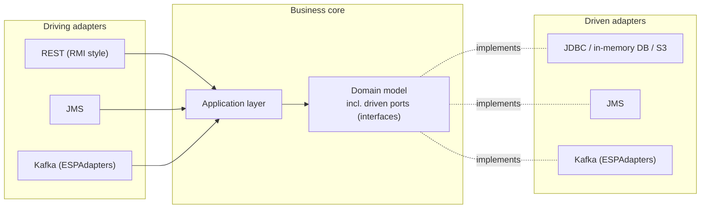

[](https://central.sonatype.com/artifact/io.jexxa/jexxa-web)
[](https://opensource.org/licenses/Apache-2.0)
[](https://github.com/jexxa-projects/Jexxa/actions/workflows/codeql-analysis.yml)
[](https://sonarcloud.io/summary/overall?id=jexxa-projects_Jexxa)
[](https://github.com/jexxa-projects/Jexxa/actions/workflows/maven.yml)

# Jexxa — A Ports & Adapters Framework for Java

**Jexxa** is a lightweight, opinionated framework for building durable, modular, and testable business applications using **Domain-Driven Design** and **Hexagonal Architecture** (Ports & Adapters).

> Jexxa is not a general-purpose framework like Spring. It focuses solely on the business layer and clear system boundaries.

**Quick links:** [Quickstart](#quickstart) · [Architecture](https://jexxa-projects.github.io/Jexxa/jexxa_architecture.html) · [Reference](https://jexxa-projects.github.io/Jexxa/jexxa_reference.html) · [Tutorials](https://github.com/jexxa-projects/JexxaTutorials)

## Why Jexxa?

Business software often lives much longer than the technologies used to build it. Databases, messaging systems, and cloud providers change. Your domain knowledge should not.

Jexxa helps teams build applications where:

- Business logic remains technology-independent
- Domain models stay clean and maintainable
- Infrastructure can evolve without impacting core business code
- Architectural boundaries remain visible and enforceable
- Development teams can collaborate effectively using DDD principles

## Quickstart

**Requirements:** Java 25 or higher, and Maven or Gradle.

### Add dependencies

Maven:

```xml
<dependency>
    <groupId>io.jexxa</groupId>
    <artifactId>jexxa-web</artifactId>
    <version>9.1.0</version> <!-- latest version: see Maven Central badge above -->
</dependency>

<dependency>
    <groupId>org.slf4j</groupId>
    <artifactId>slf4j-simple</artifactId>
    <version>2.0.20</version>
</dependency>
```

Gradle:

```groovy
implementation "io.jexxa:jexxa-web:9.1.0"
implementation "org.slf4j:slf4j-simple:2.0.20"
```

### Hello World

```java
import io.jexxa.core.JexxaMain;
import io.jexxa.drivingadapter.rest.RESTfulRPCAdapter;

public final class HelloJexxa {
    public String greetings() {
        return "Hello Jexxa";
    }

    static void main() {
        var jexxaMain = new JexxaMain(HelloJexxa.class);

        jexxaMain
                .bind(RESTfulRPCAdapter.class).to(HelloJexxa.class)
                .run();
    }
}
```

Start the application and call the endpoint:

```shell
curl http://localhost:7501/HelloJexxa/greetings
```

`RESTfulRPCAdapter` exposes the public methods of the bound class as REST endpoints (RMI style), so `greetings()` becomes `/HelloJexxa/greetings`.


Full example: [HelloJexxa tutorial](https://github.com/jexxa-projects/JexxaTutorials/tree/main/HelloJexxa)

### Beyond Hello World

Hello World only shows a driving adapter. The core idea of Jexxa is that your domain code stays unchanged when you swap infrastructure, for example from an in-memory repository to a JDBC database. See the [JexxaTutorials](https://github.com/jexxa-projects/JexxaTutorials) for complete examples.


### Configuration

Jexxa reads `jexxa-application.properties` from the classpath.

- [Example configuration](https://github.com/jexxa-projects/Jexxa/blob/master/jexxa-web/src/test/resources/jexxa-application.properties)
- [Configuration reference](https://jexxa-projects.github.io/Jexxa/jexxa_reference.html#_application_configuration)


## Key Features

- **Technology-agnostic core:** clean separation of domain logic and infrastructure
- **Visible control flow:** clear orchestration of application logic
- **Team-friendly design:** scales well with cross-functional DDD teams
- **Built-in adapters:** REST (RMI style), JMS, JDBC, in-memory DB, S3 storage
- **Event streaming:** Apache Kafka and Kafka-compatible platforms via the [ESPAdapters](https://github.com/jexxa-projects/ESPAdapters) project
- **Resilient microservice patterns:** transactional outbox, fail-fast startup combined with controlled retry strategies
- **Architecture validation:** Are part of Jexxa's maven archetype, enforces architectural rules and prevents erosion through automated validation


### Architecture at a glance



All arrows show source-code dependencies: every adapter depends on the business core, never the other way round (dependency inversion).

Read more in the [architecture overview](https://jexxa-projects.github.io/Jexxa/jexxa_architecture.html).

## Jexxa in Practice

The architectural principles behind Jexxa have been applied in industrial production environments since 2020, including systems for blast furnace, steelworks, and rolling mill processes. Such systems must remain maintainable for decades while integrating both legacy systems and modern cloud-native technologies.

Jexxa has also been evaluated in SaaS and cybersecurity environments. Based on package download telemetry, artifacts of the Jexxa Projects ecosystem are used by organizations across industries such as cybersecurity, SaaS, fintech, analytics, and industrial manufacturing.

Whether in a steel plant or a cloud platform, the challenge is the same: complex business logic that must stay stable for a long time. Jexxa addresses it by keeping that logic independent of databases, messaging systems, and frontends.


## Requirements and Compatibility

- Java **25 or higher**
- Maven or Gradle

### Why Java 25?

Java 25 is not technically essential for Jexxa. Requiring a current LTS release is a deliberate decision: the Jexxa Projects ecosystem is designed to connect legacy and modern systems, and any component that integrates legacy systems should itself be built on a modern language level. This keeps integration code maintainable and encourages updating legacy landscapes instead of conserving them.


## Documentation and Ecosystem

- [JexxaTutorials](https://github.com/jexxa-projects/JexxaTutorials): sample projects and usage patterns
- [JexxaArchetypes](https://github.com/jexxa-projects/JexxaArchetypes): Maven archetypes for a quick start
- [Reference guide](https://jexxa-projects.github.io/Jexxa/jexxa_reference.html)
- [Architecture overview](https://jexxa-projects.github.io/Jexxa/jexxa_architecture.html)
- [Build instructions](https://github.com/jexxa-projects/Jexxa/blob/master/docs/BUILD.md)

### Related projects

- [Addend](https://github.com/jexxa-projects/Addend): domain annotations for DDD
- [JLegMed](https://github.com/jexxa-projects/JLegMed): semantic bridging of legacy and modern systems
- [DigiSpine](https://github.com/jexxa-projects/DigiSpine): digital backbone for functionally networking business applications, based on domain events across domain boundaries

### Built with

- [ClassGraph](https://github.com/classgraph/classgraph)
- [Javalin](http://javalin.io/)

## Open Source and Commercial Services

**Jexxa is and will remain open source.** Using the project does not require a commercial agreement.

Organizations that want dedicated support can use optional consulting and implementation services from [MCR Industrial Intelligence](https://mcr-intelligence.de) for domain-driven architecture and integration into existing system landscapes.

## Contributing

Contributions are welcome:

- Open an issue to start a discussion
- Submit a PR with tests and updated documentation
- Questions or suggestions? Open an issue or start a [GitHub Discussion](https://github.com/jexxa-projects/Jexxa/discussions)

## License

- Source code: [Apache 2.0 License](https://github.com/jexxa-projects/Jexxa/blob/master/LICENSE) ([TLDR legal](https://tldrlegal.com/license/apache-license-2.0-(apache-2.0)))
- Documentation: [Creative Commons](https://creativecommons.org/licenses/by/4.0/)
- © 2020–2026 Michael Repplinger
